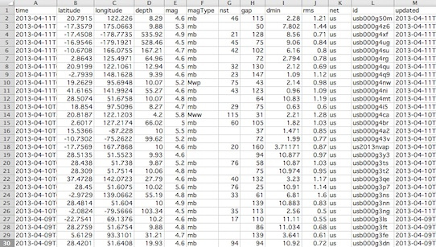
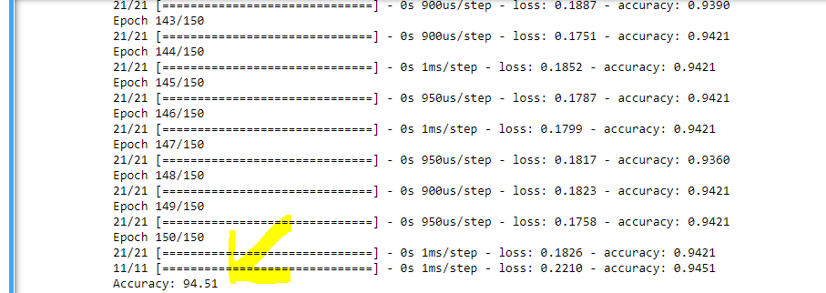
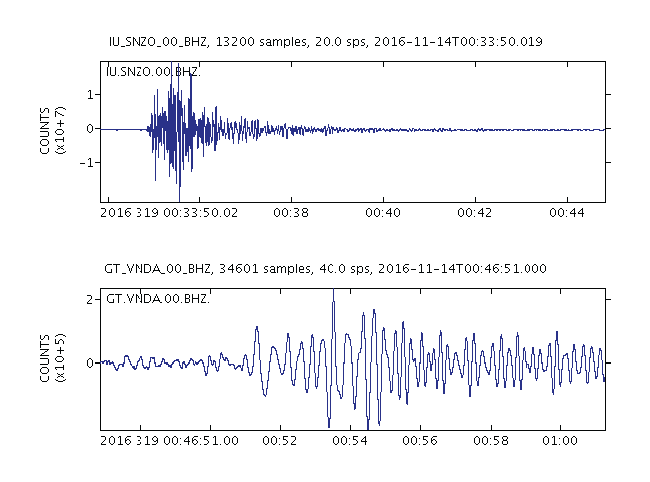
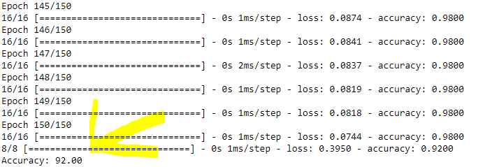
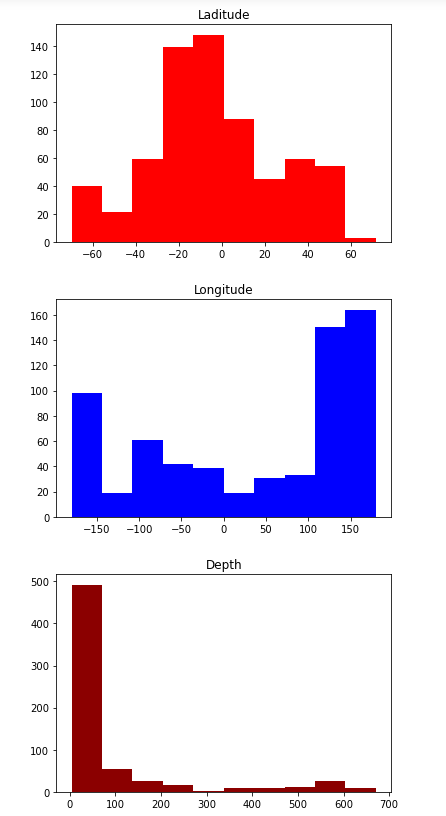
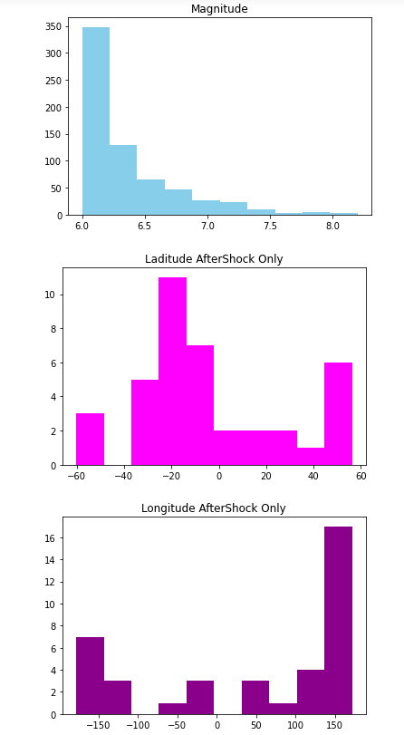
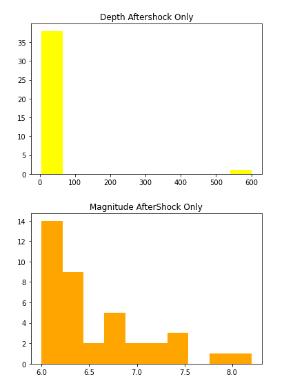

# The Results

This python project uses federal csv data (U.S. Geological Survey) and a public seismological data API (Iris Federator) in addition to TensorFlow
to graph earthquake data, algorithmically extract aftershocks in the data, and to predict if an earthquake will be followed by an aftershock within 24-48 hours. 

The results varied between 92 and 94 percent accuracy based on the data sets that were used. The csv data (which was simpler and had a wider breadth of data)
was the more accurate data set with the normalized waveform graph data (from the API) not being too far behind.

## CSV Data Model
||
|:--:| 
|*Credit: USGS (U.S. Geological Survey)*|

||
|:--:| 

## Waveform Data Model
||
|:--:| 
|*Credit: USGS (U.S. Geological Survey)*|

||
|:--:| 

## Graphs of Earthquake Data Set
 

